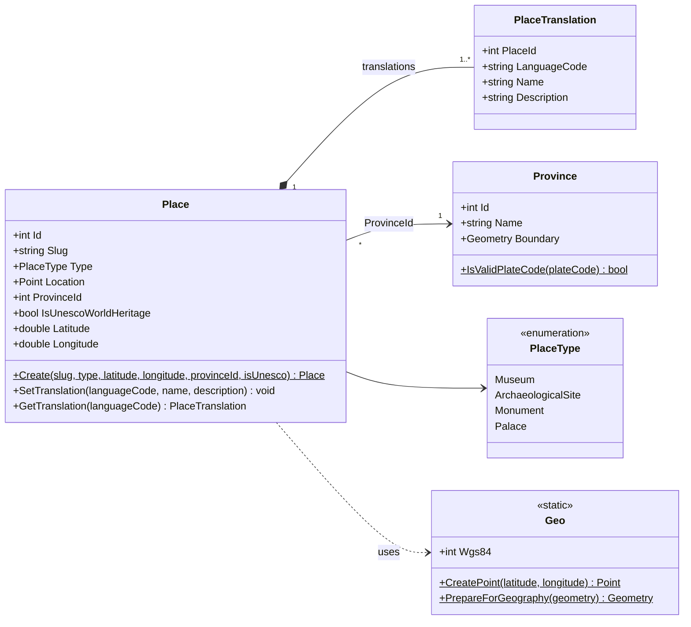
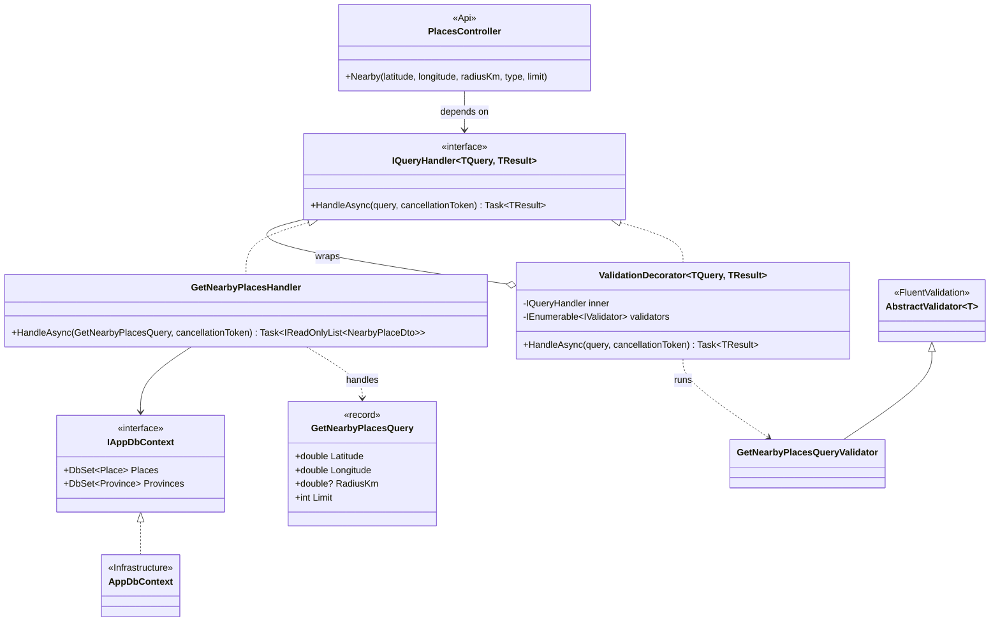

# UML class diagram

Main classes of the backend after M2. Rendered by GitHub from the Mermaid code below.

## Domain

- `Place` owns its translations (composition): they are created, changed and deleted only through `Place`.
- `Place` refers to `Province` by id. Spatial queries also check the real border (`Boundary.Contains(Location)`).

## Application: hand-written CQRS

One example use case is shown; every other query follows the same shape:

| Query | Result | What it does |
| --- | --- | --- |
| `SearchPlacesQuery` | `PagedResult<PlaceSummaryDto>` | Filter, search and page |
| `ListPlacesQuery` | `IReadOnlyList<PlaceSummaryDto>` | All matching places, for GeoJSON |
| `GetPlaceBySlugQuery` | `PlaceDetailsDto?` | One place with its description |
| `GetNearbyPlacesQuery` | `IReadOnlyList<NearbyPlaceDto>` | Nearest places, optional radius |
| `GetPlacesWithinGeometryQuery` | `IReadOnlyList<PlaceSummaryDto>` | Inside a shape or within a buffer of it |
| `GetProvincesQuery` | `IReadOnlyList<ProvinceDto>` | Provinces with place counts |
| `GetProvinceBoundariesQuery` | `IReadOnlyList<ProvinceBoundaryDto>` | Simplified borders, for GeoJSON |
| `GetPlacesInProvinceQuery` | `IReadOnlyList<PlaceSummaryDto>?` | Point-in-polygon for one province |

**Why no MediatR?** The pattern needs only two small types here (`IQueryHandler` and `ValidationDecorator`),
registered by scanning the assembly. Controllers ask the DI container for `IQueryHandler<TQuery, TResult>`
and receive the handler already wrapped in validation, the same job a MediatR pipeline behaviour does.
