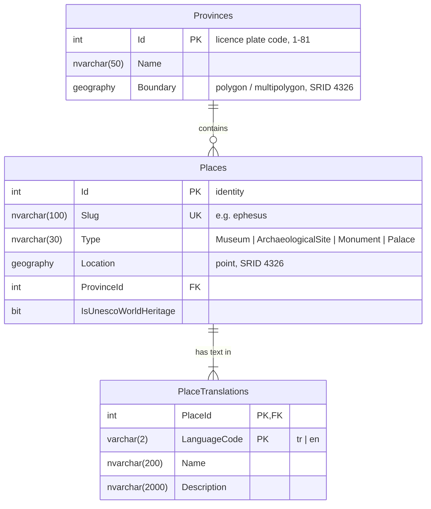

# Entity–relationship diagram

Database schema after milestone M1. Generated from the EF Core model in
`backend/src/KulturRotasi.Infrastructure/Persistence`.

## Design notes

- **`geography` instead of `geometry`.** `geography` works on the curved earth, so `STDistance`
  returns metres and buffers are real circles. `geometry` treats coordinates as a flat plane,
  which is fine for small areas but distorts distances across a country.
- **Spatial indexes** on `Places.Location` and `Provinces.Boundary` are created in the
  migration with plain SQL, because EF Core cannot model them.
- **Translations in their own table.** Adding a language means adding rows, not columns.
  The primary key `(PlaceId, LanguageCode)` guarantees one text per language.
- **Province id is the plate code.** It is a natural, stable key that everyone in Türkiye knows,
  so the database does not generate it.
